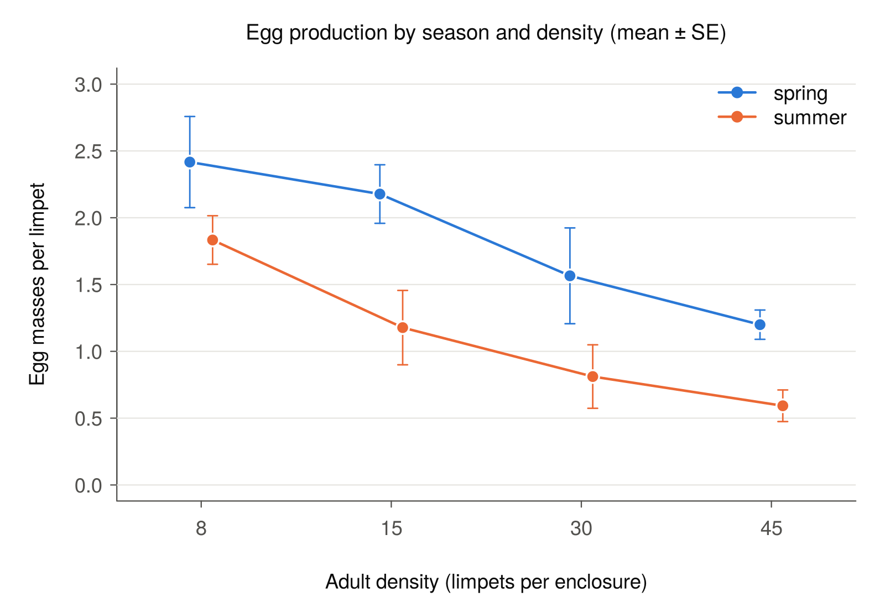
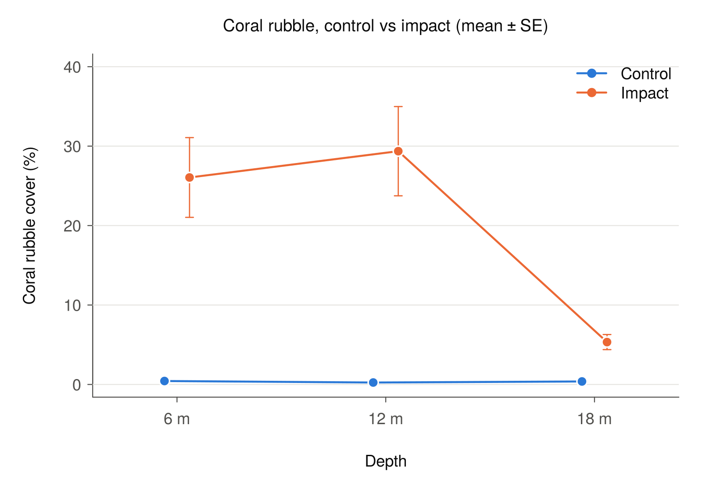

# Data analysis portfolio – Angelica Faraci

Marine biologist (MSc in Marine Biology, University of Bologna). This repository collects the statistical analyses and the data tools I wrote during my MSc: experimental design and biostatistics in R, and Excel VBA and Python tools to prepare DNA metabarcoding datasets.

## Contents

| Folder | What it shows | Tools |
|---|---|---|
| [statistics-in-r](statistics-in-r/) | Analysis of ecological and environmental data from the course *Experimental Design and Data Analysis*: one-way, two-way and nested ANOVA with fixed, random and mixed factors, linear and polynomial regression, correlation. Every analysis checks its assumptions and is documented with figures and results. | R, GAD, chemCal, Hmisc |
| [thesis-data-tools](thesis-data-tools/) | Tools written with Cosmin Haja to prepare the metabarcoding data of my thesis (18S and COI): formatting the taxonomic classification, removing contaminants and ASVs found in negative controls, checking every name against the World Register of Marine Species (WoRMS), counting ASVs per taxon and sample. | Excel VBA, Python (openpyxl, requests, WoRMS REST API), pytest |

 

## Skills

- **Experimental design and statistics:** choosing the model from the sampling design, checking assumptions (homogeneity of variances, normality), transformations, post-hoc tests (Tukey, SNK), regression diagnostics.
- **Metabarcoding data:** ASV tables, taxonomic assignment and its confidence scores, negative controls and contamination, taxonomic standardisation with WoRMS.
- **Automation:** Excel macros that process tables with tens of thousands of rows in seconds; Python scripts with a command-line interface, a shared API client and offline tests.

## A note on the data

My MSc thesis is under embargo, so `thesis-data-tools` contains only code and small invented example files. Some course exercises used field data that are not mine to publish: for those analyses the data are simulated with the same sampling design, as explained in each folder.

## Contact

[LinkedIn](https://www.linkedin.com/in/angelica-faraci)
