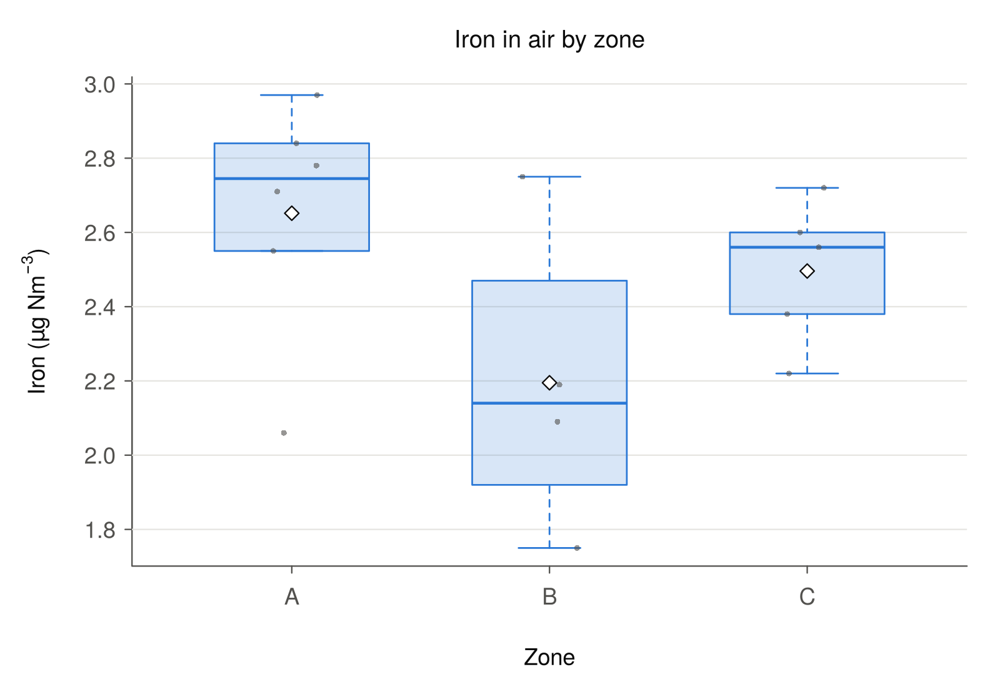
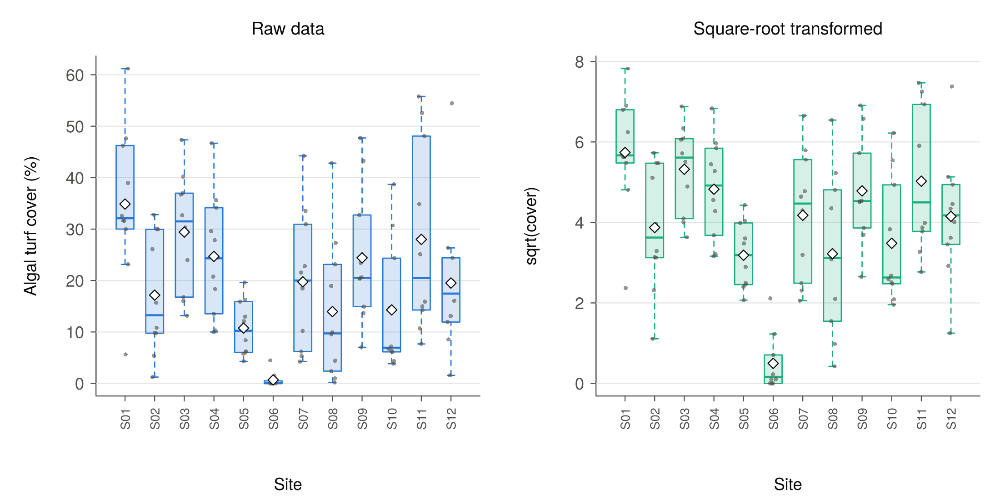
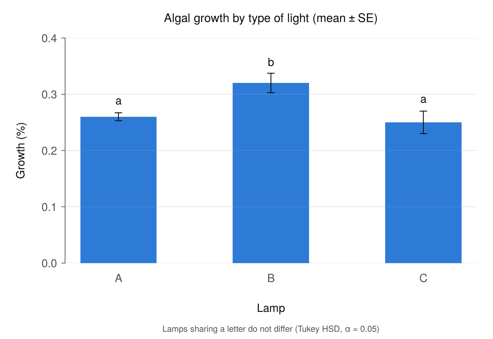

# One-way ANOVA

Three examples of one-way analysis of variance, from the simplest case to a random factor that needs transformed data.

Script: [`analysis.R`](analysis.R) · full output: [`output.txt`](output.txt)

## 1. Iron in air across three zones

- **Question:** does the mean iron concentration in air differ among three zones?
- **Design:** one fixed factor (zone, 3 levels), unbalanced (n = 6, 4, 5).
- **Method:** Bartlett's test for homogeneity of variances, then one-way ANOVA.

**Result:** variances are homogeneous (Bartlett K² = 1.69, P = 0.43). Mean iron is 2.65, 2.20 and 2.50 µg Nm⁻³ in zones A, B and C, but the difference is not significant (F₂,₁₂ = 2.54, P = 0.12).

## 2. Algal turf cover at 12 reef sites (simulated data)

- **Question:** does algal turf cover vary among sites?
- **Design:** one random factor (site, 12 sites sampled at random), n = 10 replicates per site.
- **Method:** Bartlett's test, square-root transformation, ANOVA, variance components.

**Result:** variances are heterogeneous on the raw data (Bartlett P < 0.001), because the variance of cover grows with the mean, but homogeneous after a square-root transformation (P = 0.18). Cover differs strongly among sites (F₁₁,₁₀₈ = 9.25, P < 0.001). Because site is a random factor, post-hoc comparisons between particular sites are not meaningful; instead, the variance component shows that about **45% of the variability** in cover is due to differences among sites, the rest to variability within sites.

## 3. Algal growth under three types of light

- **Question:** does algal growth depend on the type of lamp?
- **Design:** one fixed factor (lamp, 3 levels chosen on purpose), n = 4, 3, 3.
- **Method:** Bartlett's test, ANOVA, Tukey HSD post-hoc test.

**Result:** variances are homogeneous (P = 0.43). Growth differs among lamps (F₂,₇ = 6.45, P = 0.026). Tukey's test shows that lamp B gives higher growth (0.32%) than lamps A (0.26%, P = 0.046) and C (0.25%, P = 0.032), which do not differ from each other (P = 0.87).

## Data

All three datasets are in `data/`. The algal turf data are simulated with the same design as the course exercise (see [`../simulate_data.R`](../simulate_data.R)).
