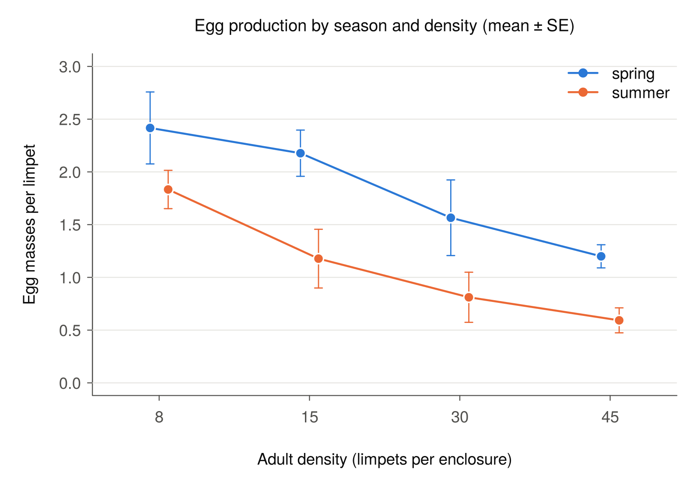
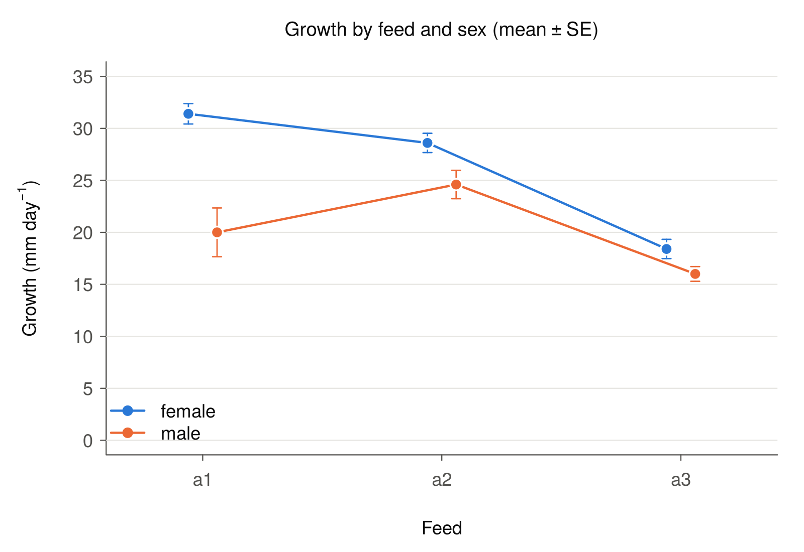
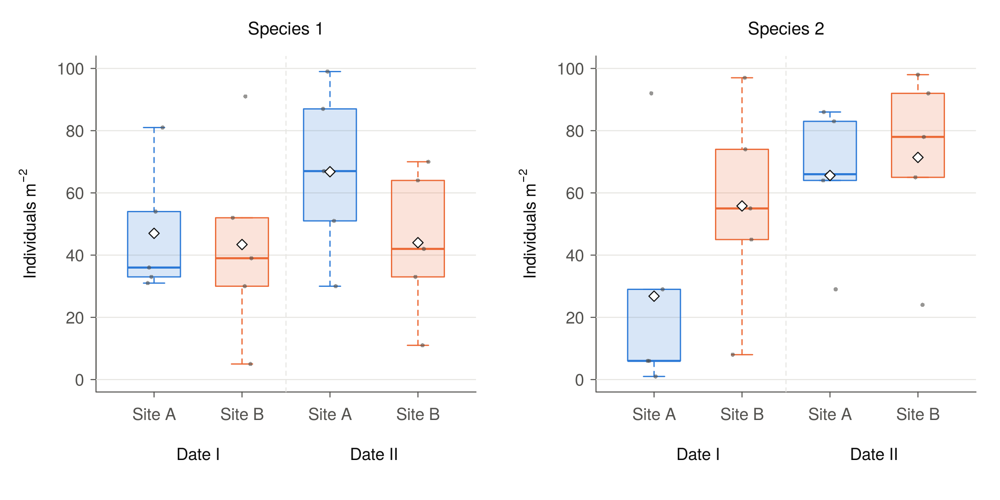

# Two-way crossed ANOVA

Three examples with two crossed factors: two fixed factors without and with interaction, and a mixed model (one fixed and one random factor). The analyses use the [GAD](https://cran.r-project.org/package=GAD) package, which builds the correct F-ratios for each design and provides Cochran's C test and the Student-Newman-Keuls (SNK) test.

Script: [`analysis.R`](analysis.R) · full output: [`output.txt`](output.txt)

## 1. Limpet egg production: season × density

- **Question:** do season and adult density affect egg production of the limpet *Siphonaria diemenensis*? (data from Quinn 1988)
- **Design:** season (2 levels, fixed) × density (8, 15, 30, 45 limpets per enclosure, fixed), n = 3 enclosures per combination.
- **Method:** Cochran's C test, two-way ANOVA, SNK test on density.

**Result:** variances are homogeneous (C = 0.26, P = 0.93). Both factors have a significant effect (season F₁,₁₆ = 17.8, P < 0.001; density F₃,₁₆ = 9.7, P < 0.001) and there is no interaction (F₃,₁₆ = 0.30, P = 0.82): the effect of density is the same in both seasons. Egg production is higher in spring and decreases as density increases (SNK: 8 > 30 and 45; 15 > 45).

## 2. Growth: feed type × sex

- **Question:** does growth depend on the type of feed, and is the effect the same for males and females?
- **Design:** feed (3 levels, fixed) × sex (fixed), n = 5 per combination.
- **Method:** Cochran's C test, transformations, two-way ANOVA with α = 0.01, SNK tests within the interaction.

**Result:** variances are heterogeneous (C = 0.52, P = 0.023) and neither the square-root nor the log transformation helps (both make it worse). Since ANOVA is robust when the design is balanced, the raw data were analysed with a stricter significance level (α = 0.01). The feed × sex interaction is significant (F₂,₂₄ = 6.56, P = 0.005), so the levels of each factor were compared within the levels of the other:

- feed a3 gives the lowest growth in both sexes;
- females grow more than males only with feed a1 (31.4 vs 20.0 mm day⁻¹), which explains the interaction.

## 3. Species abundance: site × date (mixed model)

- **Question:** does the abundance of two species differ between two sites and two sampling dates?
- **Design:** site (2 levels, fixed) × date (2 levels, random), n = 5 replicates.
- **Method:** mixed-model ANOVA, pooling of non-significant terms.

**Result:** in a mixed model the fixed factor is tested against the site × date interaction, not against the residual, so the test for site has only 1 denominator degree of freedom. For species 1 nothing is significant (site P = 0.40, date P = 0.40, interaction P = 0.43). Because the interaction has P > 0.25 it can be pooled with the residual (Underwood 1997), which gives a more powerful test, but site is still not significant (F₁,₁₇ = 1.28, P = 0.28). For species 2 no term is significant either (date P = 0.07).

## Data

All three datasets are included in `data/`.

## References

- Quinn G.P. (1988). Ecology of the intertidal pulmonate limpet *Siphonaria diemenensis* Quoy et Gaimard. II. Reproductive patterns and energetics. *Journal of Experimental Marine Biology and Ecology* 117: 137–156.
- Underwood A.J. (1997). *Experiments in Ecology: Their Logical Design and Interpretation Using Analysis of Variance*. Cambridge University Press.
