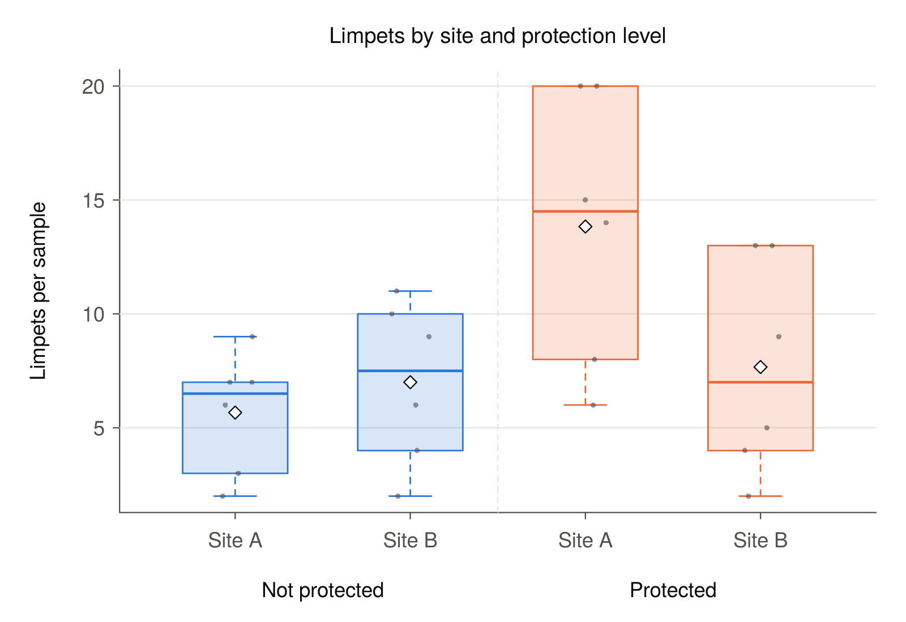
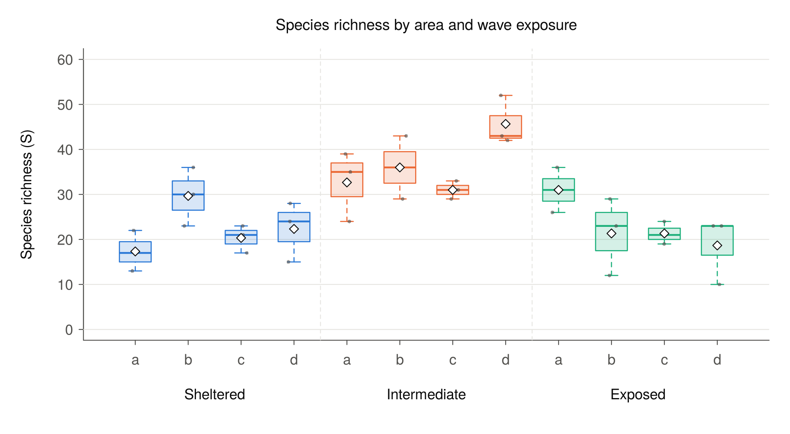
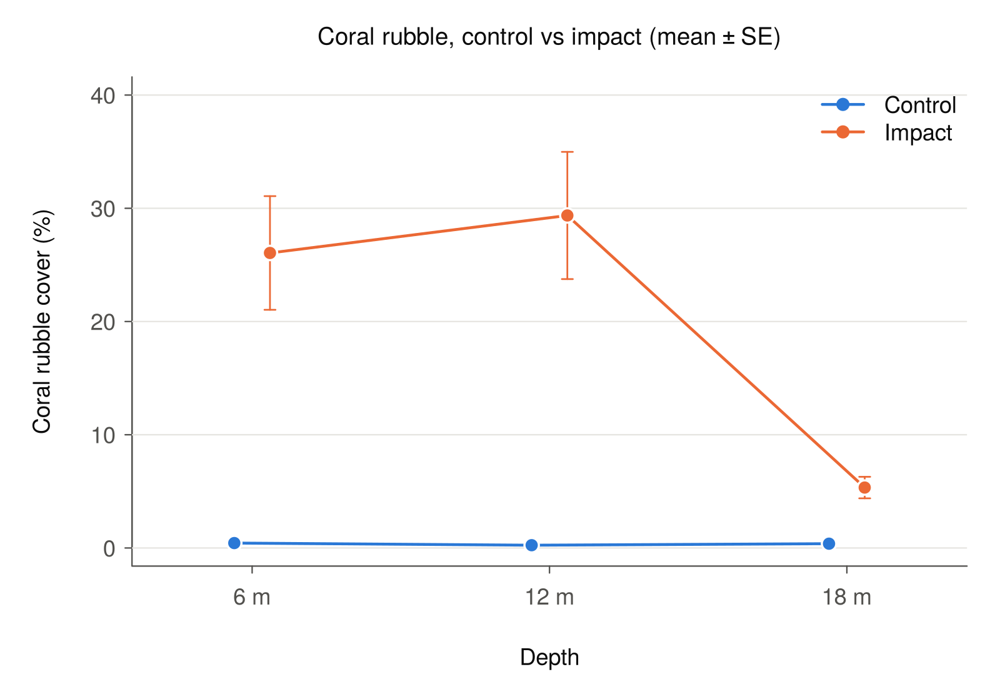

# Nested (hierarchical) ANOVA

In a nested design the levels of one factor exist only within a level of another: site "A" in a protected area is a different place from site "A" outside it. The nested factor (sites, areas) is random and is the replication unit for the factor above it, so getting the F-ratio denominators right is the key step. The analyses use the [GAD](https://cran.r-project.org/package=GAD) package.

All three datasets are **simulated**, with the same designs as the course exercises (see [`../simulate_data.R`](../simulate_data.R)); they do not describe real places.

Script: [`analysis.R`](analysis.R) · full output: [`output.txt`](output.txt)

## 1. Limpets and marine protection

- **Question:** is limpet density different inside and outside a marine protected area?
- **Design:** protection (protected / not protected, fixed); site (2 per protection level, random, nested in protection); n = 6 samples per site.
- **Method:** Cochran's C test, nested ANOVA.

**Result:** variances are homogeneous (C = 0.45, P = 0.32). Limpets are more abundant in the protected area on average (10.8 vs 6.3 per sample), but the difference is not significant (F₁,₂ = 1.96, P = 0.30), and sites within the same protection level do not differ significantly either (F₂,₂₀ = 3.11, P = 0.07). The test for protection uses the variability among sites as its error term and has only 2 denominator degrees of freedom: with 2 sites per level the design has very little power, and more sites would be needed to detect an effect of protection.

## 2. Benthic species richness and wave exposure

- **Question:** does benthic species richness depend on wave exposure?
- **Design:** exposure (sheltered, intermediate, exposed, fixed); area (4 per exposure level, random, nested in exposure); n = 3 replicates per area.
- **Method:** Cochran's C test, nested ANOVA, SNK test.

**Result:** variances are homogeneous (C = 0.18, P > 0.99). Richness varies among areas with the same exposure (F₉,₂₄ = 2.85, P = 0.020) and exposure has a significant effect (F₂,₉ = 7.39, P = 0.013). Exposure is tested against the variability among areas, with only 9 degrees of freedom: the replicates within an area are not independent evidence about exposure. The SNK test shows that intermediate exposure has a higher mean richness (36.3 species) than sheltered (22.4) and exposed areas (23.1), which do not differ from each other.

## 3. Coral rubble at control and impacted reefs

- **Question:** is coral rubble cover higher at impacted reefs than at control reefs, and does the difference change with depth?
- **Design:** impact (control / impact, fixed) × depth (6, 12, 18 m, fixed); site (4 per impact level, random, nested in impact and crossed with depth); n = 5 replicates.
- **Method:** Cochran's C test, power transformation (x^0.2), ANOVA with five terms, SNK tests within the interaction.

**Result:** rubble is almost absent at control sites, so variances are strongly heterogeneous (P < 0.001); after an x^0.2 transformation they are homogeneous (P = 0.061). The impact × depth interaction is significant (F₂,₁₂ = 4.96, P = 0.027), so the effect of impact was examined at each depth. SNK tests show that rubble cover is higher at impacted than at control reefs at every depth (mean 26.1% at 6 m, 29.4% at 12 m and 5.3% at 18 m, against 0.4% or less at control reefs) and that at impacted reefs it is lower at 18 m than at 6 and 12 m.

## Data

The three simulated datasets are in `data/`.
