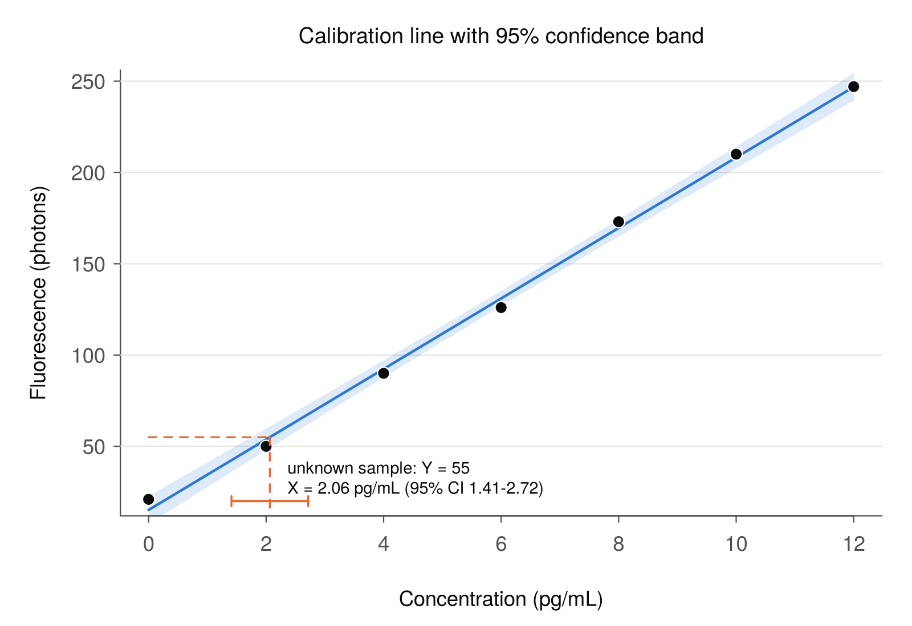
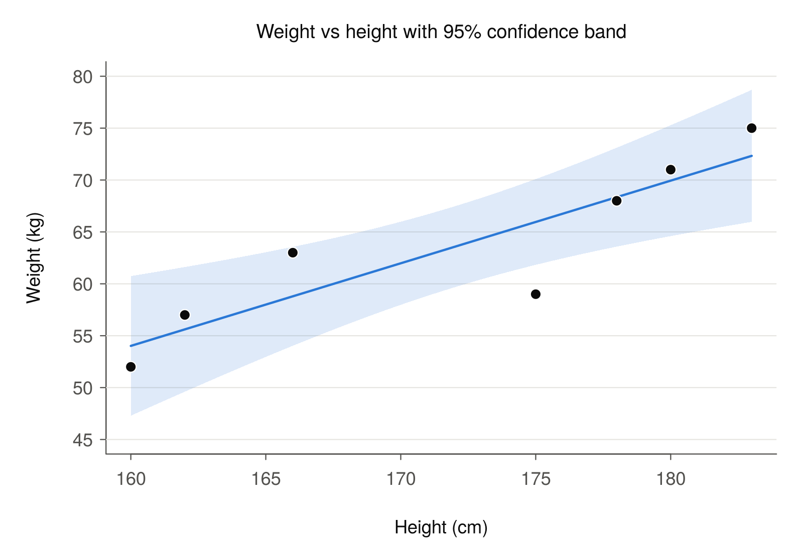
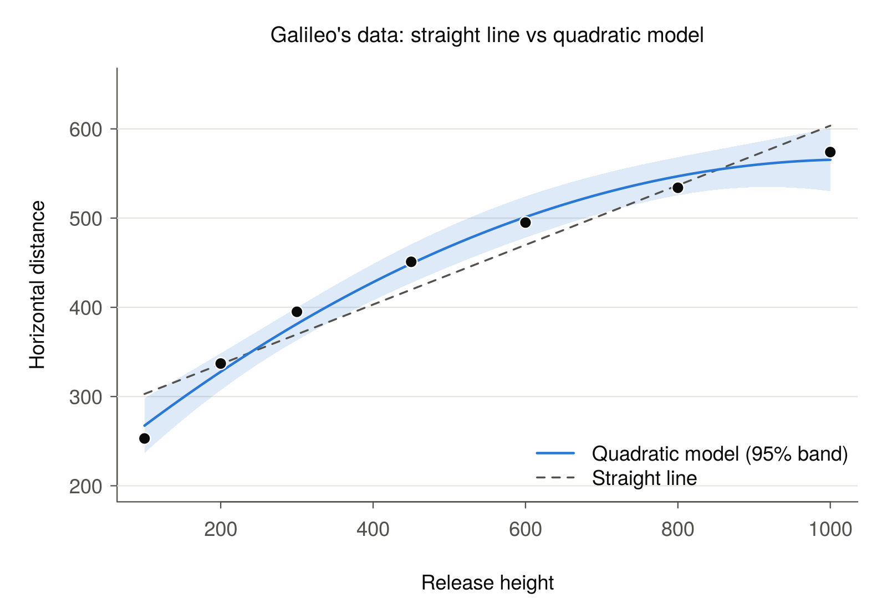

# Linear regression

Simple and polynomial linear regression, with tests on the coefficients, residual diagnostics and an inverse prediction from a calibration line.

Script: [`analysis.R`](analysis.R) · full output: [`output.txt`](output.txt)

## 1. Calibration line: fluorescence vs concentration

- **Question:** how well does fluorescence predict concentration, and what is the concentration of an unknown sample?
- **Data:** 7 standard solutions from 0 to 12 pg/mL.
- **Method:** least-squares regression, t-tests on slope and intercept (against 0 and against a reference value), 95% confidence intervals and band, residual diagnostics, inverse prediction ([chemCal](https://cran.r-project.org/package=chemCal)), regression through the origin.

**Result:** fluorescence = 15.18 + 19.30 × concentration (R² = 0.998, F₁,₅ = 2228, P < 0.001). The slope is clearly different from 0 (95% CI 18.25–20.35) and the intercept is too (P = 0.004): the blank gives a signal above zero. An unknown sample with fluorescence 55 has an estimated concentration of **2.06 pg/mL** (95% CI 1.41–2.72).

Forcing the line through the origin is not justified here: the model with intercept fits significantly better (F₁,₅ = 26.5, P = 0.004). The R² of a model through the origin is computed around 0 rather than around the mean, so it cannot be compared with the usual R².

Residual diagnostics: [`figures/calibration_diagnostics.png`](figures/calibration_diagnostics.png)

## 2. Body weight vs height

- **Question:** how much does body weight increase with height?
- **Data:** 7 individuals.
- **Method:** least-squares regression, confidence band, residual diagnostics.

**Result:** weight = −73.4 + 0.80 × height (R² = 0.80, F₁,₅ = 20.1, P = 0.007): on average 0.8 kg more for every extra centimetre (95% CI 0.34–1.25 kg/cm). With only 7 points the confidence interval of the slope is wide.

## 3. Polynomial regression: Galileo's data

- **Question:** is the relationship between the release height of a ball on an inclined ramp and the horizontal distance it travels linear? (data from Galileo's notes, 1608)
- **Method:** straight-line and quadratic models compared with an F-test.

**Result:** the quadratic model (R² = 0.990) fits significantly better than the straight line (F₁,₄ = 25.5, P = 0.007): the distance grows less than proportionally with height.

## Data

`data/calibration_fluorescence.csv` and `data/height_weight.csv` are included; Galileo's data are written in the script.
