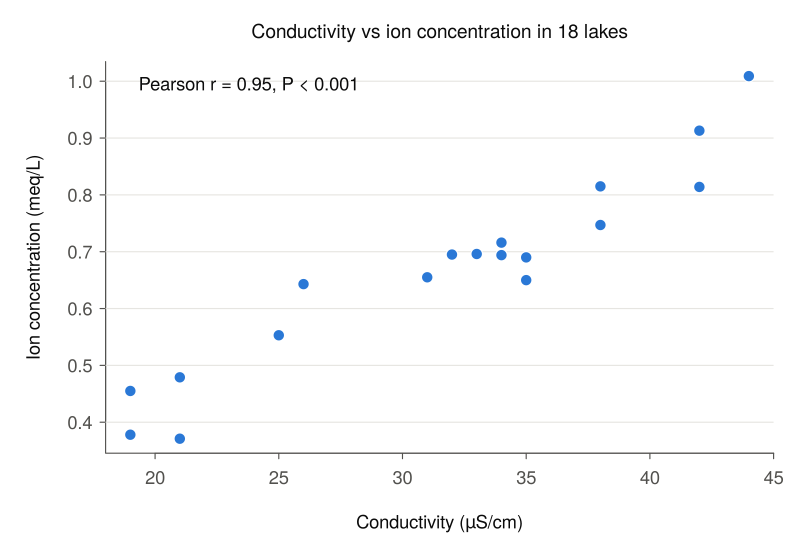
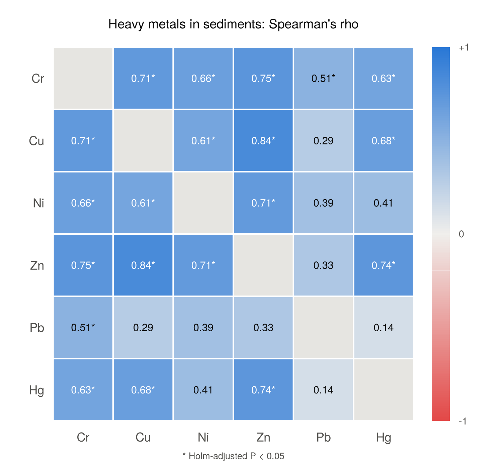

# Correlation

Parametric and rank-based correlation, from a single pair of variables to a correlation matrix with corrected P-values.

Both datasets are **simulated**, with the same designs as the course exercises (see [`../simulate_data.R`](../simulate_data.R)); they do not describe real places.

Script: [`analysis.R`](analysis.R) · full output: [`output.txt`](output.txt) · correlation tables: [`results/`](results/)

## 1. Conductivity vs ion concentration in 18 lakes

- **Question:** how strongly are conductivity and ion concentration associated?
- **Method:** Shapiro-Wilk normality tests, Pearson's r, Spearman's ρ and Kendall's τ with their tests.

**Result:** both variables are compatible with a normal distribution (P = 0.20 and 0.57), so Pearson's coefficient is appropriate. The correlation is very strong and positive: r = 0.95 (95% CI 0.88–0.98, t₁₆ = 12.64, P < 0.001). The rank-based coefficients agree (ρ = 0.92, τ = 0.79). Pearson measures linear association; Spearman and Kendall use ranks and measure any monotonic association, so they are robust to outliers and skewed data.

## 2. Heavy metals in marine sediments

- **Question:** which metals tend to occur together in the sediments?
- **Data:** 36 samples (4 areas × 3 sites × 3 replicates), concentrations of Cr, Cu, Ni, Zn, Pb and Hg in mg/kg; one area is contaminated.
- **Method:** scatterplot matrix, Spearman correlation matrix ([Hmisc](https://cran.r-project.org/package=Hmisc)), Holm correction for 15 tests, comparison with Pearson.

**Result:** Hg is very skewed (0.2 to 15.3 mg/kg), so the rank-based Spearman coefficient was used. Cr, Cu, Zn and Hg are strongly correlated with each other (ρ = 0.63–0.84, Holm-adjusted P < 0.001); Pb is the least correlated metal (only Pb–Cr is significant). These correlations should be read with care: the samples are not independent (replicates within sites within areas) and the contaminated area has much higher concentrations of most metals, so part of the correlation reflects differences among areas. A nested ANOVA or a multivariate analysis would describe this design better.

## Data

The two simulated datasets are in `data/`.
