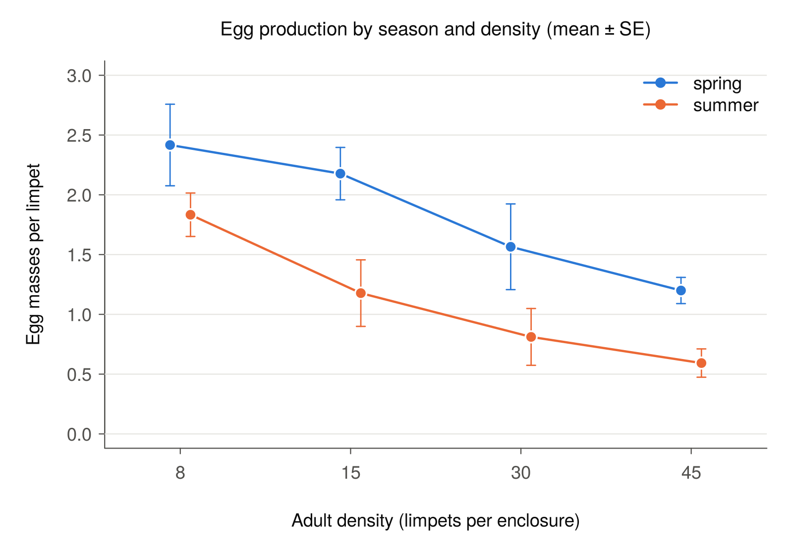
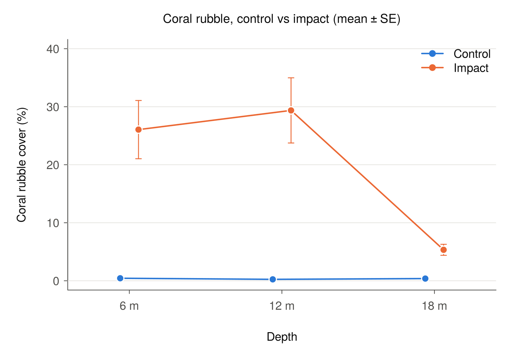

# Statistics in R

Statistical analyses of ecological and environmental data, written in R during the course *Experimental Design and Data Analysis* (Disegni sperimentali e analisi dati) of my MSc in Marine Biology (University of Bologna) and then rewritten and documented for this portfolio.

Every analysis follows the same steps: define the question and the sampling design, check the assumptions, choose the model, test, run post-hoc comparisons where they make sense, and interpret the result.

## Contents

| Folder | Analyses | Methods |
|---|---|---|
| [01-one-way-anova](01-one-way-anova/) | Iron in air across zones; algal turf cover at reef sites; algal growth under different lamps | Bartlett's test, data transformation, fixed and random factors, variance components, Tukey HSD |
| [02-two-way-anova](02-two-way-anova/) | Limpet egg production (season × density); growth (feed × sex); species abundance (site × date) | Cochran's C test, crossed fixed and mixed models, interactions, SNK test, pooling of terms |
| [03-nested-anova](03-nested-anova/) | Limpets and marine protection; benthic species richness and wave exposure; coral rubble at control and impacted reefs | Hierarchical designs, correct F-ratio denominators, strong transformations, conservative α |
| [04-linear-regression](04-linear-regression/) | Calibration line (fluorescence); weight vs height; Galileo's data | Tests on slope and intercept, confidence bands, residual diagnostics, inverse prediction, regression through the origin, polynomial regression |
| [05-correlation](05-correlation/) | Conductivity vs ions in lakes; heavy metals in sediments | Pearson, Spearman and Kendall coefficients, correlation matrix, Holm correction |

## Examples of figures

 

## Tools

- R (base functions: `lm`, `aov`, `anova`, `TukeyHSD`, `cor.test`, base graphics)
- [GAD](https://cran.r-project.org/package=GAD): ANOVA for fixed, random and nested factors, Cochran's C and SNK tests
- [chemCal](https://cran.r-project.org/package=chemCal): inverse prediction from calibration lines
- [Hmisc](https://cran.r-project.org/package=Hmisc): correlation matrices with P-values

## How to run

1. Install the packages once: `install.packages(c("GAD", "chemCal", "Hmisc"))`
2. Set R's working directory to one of the analysis folders (R GUI on Windows: *File > Change dir...*).
3. Run `source("analysis.R")`. The figures are saved in `figures/`.

Each folder also contains `output.txt`, the full console output of its script, so the results can be read without running anything.

## Data

All datasets are in the `data/` folder of each analysis. Some course exercises used real field data that are not mine to publish: for those analyses I generated new data with the same sampling design (factors, levels and replicates) but invented values, using [`simulate_data.R`](simulate_data.R). Each README says which datasets are simulated; simulated results do not describe real places.
